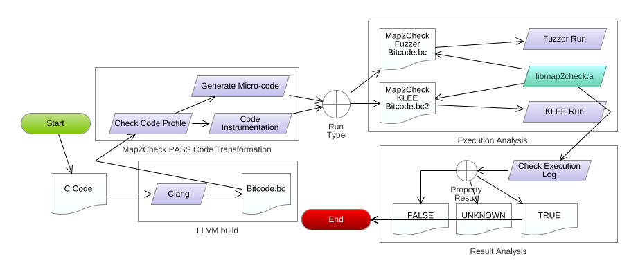

[](../master/LICENSE)
[](https://travis-ci.org/hbgit/map2check-library)
[](https://codecov.io/gh/hbgit/map2check-library)

# Map2Check-Library

Biblioteca de suporte à ferramenta [Map2Check](https://github.com/hbgit/map2check), reescrita em **Rust** (rewrite completo do C original). Provê rastreamento dinâmico e verificação de propriedades de segurança para programas analisados por LibFuzzer:

- Rastreamento de blocos básicos (`bbtrack`)
- Rastreamento de endereços de memória e operações de gerenciamento de memória (`memtrack`)
- Rastreamento de valores não-determinísticos gerados por LibFuzzer (`nondet`)
- Verificação de propriedades de segurança: overflow aritmético, memória inválida, assert definido pelo usuário (`analysismode`)
- API C compatível via FFI (`ffi.rs`) para integração direta com a LLVM Pass do Map2Check

## Requisitos

O projeto exige **Rust 1.82.0**, conforme definido em `rust-toolchain.toml` (edição 2021). O `rustup` seleciona automaticamente esse toolchain ao executar os comandos na raiz do projeto.

Ferramentas necessárias:

- `rustup` e `cargo`
- Componentes Rust `clippy` e `rustfmt`
- Docker, para o build da imagem
- `cargo-tarpaulin`, `cargo-audit`, `cargo-deny` e `cbindgen` para cobertura, auditoria e desenvolvimento

```sh
rustup component add clippy rustfmt
cargo install cargo-tarpaulin cargo-audit cargo-deny cbindgen
```

## Features disponíveis

As features configuradas no `Cargo.toml` são:

- `libfuzzer`: habilita a integração com o LibFuzzer.

## Build e testes

Execute os comandos a seguir na raiz do projeto:

```sh
# Compilar a biblioteca em modo release
cargo build --release

# Checar lint e possíveis erros
cargo clippy

# Verificar e formatar o código
cargo fmt

# Rodar todos os testes com todas as features ativadas
cargo test --all-features
```

O artefato principal é gerado em `target/release/libmap2check.a`.

### Cobertura

A cobertura é medida com `cargo-tarpaulin` (engine LLVM), excluindo `rust/src/ffi*.rs`, e o build falha abaixo de **80%**. O CI e o `Dockerfile` usam o mesmo script:

```sh
scripts/coverage.sh                        # gate padrão de 80%
COVERAGE_FAIL_UNDER=0 scripts/coverage.sh  # só gera o relatório, sem gate
```

Os relatórios ficam em `coverage/lcov.info` e `coverage/tarpaulin-report.html`. No CI, eles são publicados como o artefato `coverage`.

### Geração do header C

O arquivo `include/map2check.h` é gerado automaticamente durante a compilação. O script `build.rs` executa o `cbindgen` usando `cbindgen.toml` e grava o resultado na pasta `include/`. Portanto, não é necessário gerar o header manualmente.

### Build via Docker

O `Dockerfile` na raiz usa um build multi-stage para compilar a biblioteca, executar os testes e gerar a cobertura:

```sh
docker build -t hbgit/map2check-library .
```

## Linting e auditoria

```sh
cargo audit
cargo deny check
```

### Proteção de branches

Fluxo: `develop` é a branch padrão do repositório. Branches de trabalho `<tipo>/issue-<N>-<slug>` (`tipo` ∈ feat, fix, docs, test, build, ci, chore) abrem PR para `develop`; releases sobem de `develop` para `master` por PR. `develop` e `master` exigem o check `build_and_test` (workflow "CI Map2Check Rust") e commits assinados; `master` exige também 1 review. A configuração está em `scripts/branch-protection.sh`:

```sh
scripts/branch-protection.sh check develop   # compara com o GitHub (exit 0/1)
scripts/branch-protection.sh apply master    # requer permissão de admin
```

Se o job `build_and_test` for renomeado, atualize `CI_CHECK` no script na mesma mudança; caso contrário, todo PR fica bloqueado esperando um check que nunca chega.

Como o check também é exigido em `master`, um PR para `master` cujo head não passe no CI fica bloqueado. Hoje o CI de `master` está vermelho, então PRs só de documentação vindos de `develop` podem ficar presos; o admin pode fazer bypass (`enforce_admins=false`). `apply` trata o script como fonte da verdade: regras adicionadas pela interface do GitHub e ausentes do payload são removidas.

## Arquitetura

### Estrutura de Módulos

```
rust/src/
├── lib.rs                     # Raiz da crate; re-exports
├── error.rs                   # Map2CheckError (thiserror)
├── state.rs                   # AnalysisState + OnceLock<Arc<Mutex<...>>>
├── ffi.rs                     # ÚNICO módulo com unsafe — extern "C" ABI
├── caller/mod.rs              # ViolatedProperty, AnalysisResult, step counter
├── nondet/
│   ├── mod.rs                 # NonDetValue (enum), NonDetEntry
│   └── libfuzzer.rs           # LLVMFuzzerTestOneInput (feature = "libfuzzer")
├── memtrack/mod.rs            # MemTrackEntry, VCC checks de memória
├── bbtrack/mod.rs             # BasicBlockEntry, busca por linha
├── analysismode/
│   ├── mod.rs                 # VccChecker trait, VccContext, VccOutcome
│   ├── assert.rs              # AssertChecker
│   ├── overflow.rs            # AddI32, SubI32, MulI32 ... (checked_* arithmetic)
│   └── memory.rs              # LoadChecker, FreeChecker, DerefChecker, MemCleanupChecker
└── output/mod.rs              # to_json(), print_json() via serde_json
```

### Conectividade com Map2Check

```
Map2Check Tool (LLVM Pass / Instrumentação)
        │
        │  extern "C" ABI  (ffi.rs)
        ▼
┌─────────────────────────────────────────────┐
│             libmap2check.a                  │
│                                             │
│  caller ─┐                                 │
│  nondet  ├──► AnalysisState                │
│  memtrack│    OnceLock<Arc<Mutex<...>>>     │
│  bbtrack ┘                                 │
│                                             │
│  analysismode ──► VccChecker trait          │
│  output   ──► serde_json                   │
└─────────────────────────────────────────────┘
```

### Decisões de Segurança

| Padrão C | Equivalente Rust |
|---|---|
| `TAILQ` globais sem lock | `OnceLock<Arc<Mutex<AnalysisState>>>` |
| `union Data` (type-punning) | `NonDetValue` enum com dados; `f32::from_bits()` |
| Buffer fixo `char[512]` sem bounds | `serde_json::to_string()` — tamanho dinâmico |
| `search_in_container_by_address` retorna ponteiro não-inicializado | `find_by_address` retorna `Option<&MemTrackEntry>` |
| Aritmética `INT_MAX/INT_MIN` manual | `i32::checked_add()`, `checked_sub()` etc. |
| `lib/json-maker.c` + `ftoa.c` | `serde_json` + `#[derive(Serialize)]` |

**Política de `unsafe`**: somente `ffi.rs` contém blocos `unsafe`. Todos os outros módulos têm `#![deny(unsafe_code)]`. Cada bloco unsafe em `ffi.rs` possui um comentário `// SAFETY:`.

## Output JSON

Ao final da análise, `print_all_containers_as_json()` emite no stdout um objeto `map2check_log` com o veredito (`result`: `"TRUE"`/`"FALSE"`), a propriedade violada e os containers `Container_TrackBBLog`, `Container_NonDetLog` e, só em violações de memória, `Container_AllocationLog`. O formato exato, com exemplos verificados contra o serializador, está em [`docs/integration-guide.md`](docs/integration-guide.md#json-report).

## Compatibilidade e releases

- [`docs/api-deltas.md`](docs/api-deltas.md): matriz de símbolos e assinaturas da API C (núcleo e passes do Map2Check) em relação ao C legado.
- [`docs/semantic-deltas.md`](docs/semantic-deltas.md): diferenças de comportamento, cada uma com caso reproduzível e teste.
- [`docs/integration-guide.md`](docs/integration-guide.md): como linkar `libmap2check.a`, ordem de chamadas e formato do relatório JSON.
- [`docs/release.md`](docs/release.md) e [`CHANGELOG.md`](CHANGELOG.md): processo de release e histórico de versões.

`tests/compat_docs.rs` falha em três casos: quando um export do header não está na matriz (ou está com a declaração errada), quando um `SD-NN` aponta para um teste que não existe e quando os exemplos JSON do guia divergem da saída real. Toda mudança na ABI C ou no relatório JSON atualiza esses documentos no mesmo PR.

Para montar o pacote de release localmente:

```sh
scripts/package-release.sh   # dist/map2check-library-<versão>-<alvo>.tar.gz + SHA256SUMS
```

## Map2Check flow com a biblioteca

<center>

</center>
