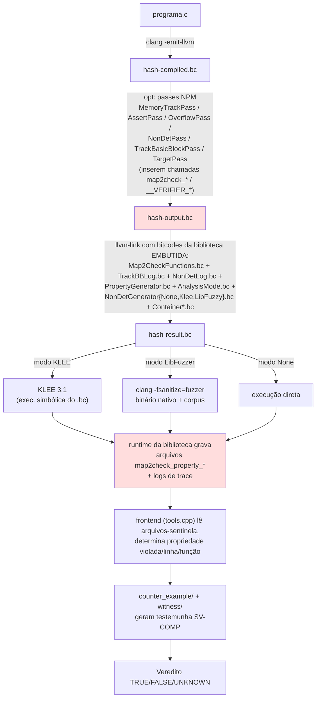
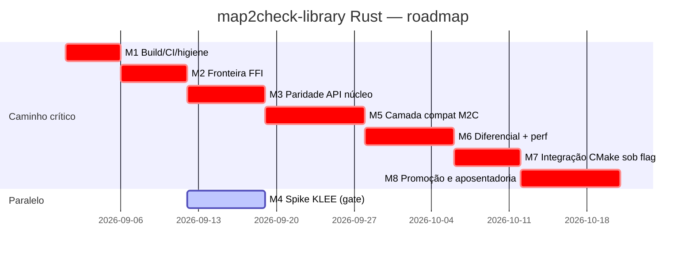

# map2check-library em Rust — Diagnóstico, Arquitetura e Plano

---

## Fase 1 — Diagnóstico de estado

### 1.1 Descoberta estrutural que redefine o problema (observado)


1. O Map2Check (`master` **e** `develop`) **não usa o repositório `map2check-library`**. Ele embute sua própria biblioteca C em `Map2Check/modules/backend/library/lib/*.c`, compilada para bitcodes por-módulo (`Map2CheckFunctions.bc`, `TrackBBLog.bc`, `NonDetLog.bc`, `AnalysisMode*.bc`, `NonDetGenerator*.bc`, …) e linkada com `llvm-link` ao programa instrumentado (`Map2Check-develop/modules/frontend/caller.cpp:226-312`).
2. Os símbolos que os passes LLVM do Map2Check inserem (`MemoryTrackPass.cpp:736-805`, `TrackBasicBlockPass.cpp`, `NonDetPass.cpp`, …) são da **família antiga**: `map2check_init(int)`, `map2check_track_bb`, `map2check_alloca`, `map2check_malloc`, `map2check_load(ptr,i64)`, `map2check_check_deref(i64,ptr)`, `map2check_free_resolved_address`, `map2check_add_store_pointer`, `map2check_non_static_alloca`, `map2check_function`, `map2check_posix`, `map2check_calloc`, `map2check_free`, `map2check_assume`, `map2check_target_function`, `map2check_non_det_*`, `map2check_wasm_*`, `__VERIFIER_*`.
3. O `map2check-library` (tanto `master` C quanto `feature/rust`) implementa uma **API redesenhada e incompatível em nomes e assinaturas**: `map2check_map_malloc`, `map2check_save_basic_block_log`, `map2check_check_load`, `map2check_binop_*`, `set_false_result`, `print_all_containers_as_json`, etc.

**Consequência:** "concluir a biblioteca" exige decidir e implementar o **lado Map2Check** da integração (novo conjunto de passes ou camada de compatibilidade de símbolos), além de terminar a biblioteca em si. O plano da Fase 3 trata as duas frentes.

### 1.2 Tabela de paridade funcional

Referências: **[C-lib]** = `map2check-library@master` (C); **[Rust]** = `feature/rust`; **[M2C]** = símbolos inseridos pelos passes do `Map2Check@develop`.

#### (a) Rust vs. biblioteca C legada do mesmo repositório

| Símbolo/área (C-lib master)                                                                                                                                     | Status em `feature/rust`                                                                                                                                                                                                                                                                                                        | Evidência                                                                                |
| --------------------------------------------------------------------------------------------------------------------------------------------------------------- | ------------------------------------------------------------------------------------------------------------------------------------------------------------------------------------------------------------------------------------------------------------------------------------------------------------------------------- | ---------------------------------------------------------------------------------------- |
| `map2check_init()`                                                                                                                                              | Implementado (sem parâmetro; M2C antigo usa `map2check_init(int isSvComp)`)                                                                                                                                                                                                                                                     | `rust/src/ffi.rs:64`                                                                     |
| `map2check_success()`                                                                                                                                           | Implementado                                                                                                                                                                                                                                                                                                                    | `ffi.rs:72`                                                                              |
| `set_false_result(prp,line,fname)`                                                                                                                              | Implementado; enum `#[repr(C)]` com a mesma ordem de variantes do C                                                                                                                                                                                                                                                             | `ffi.rs:87`; `rust/src/caller/mod.rs:9-20` vs `include/caller/caller_lib_result.h:22-31` |
| `get_current_property()` / `get_current_step()`                                                                                                                 | Implementado (`get_current_step` retorna `u64`; C retorna `long`)                                                                                                                                                                                                                                                               | `ffi.rs:103,109`                                                                         |
| `get_next_step()` / `next_current_step()`                                                                                                                       | **Ausente** como export (existe só `AnalysisState::next_step` interno)                                                                                                                                                                                                                                                          | `rust/src/state.rs:36`                                                                   |
| `print_all_containers_as_json()`                                                                                                                                | Implementado — **Divergente em formato**: `serde_json::to_string_pretty` (com espaços/quebras) vs JSON compacto manual do C; chaves `Container_BasicBlockLog`/`Container_NonDetLog`/`Container_AllocationLog` — validar contra as chaves reais impressas pelos containers C (`container_trackbb.c:47`, `container_nondet.c:46`) | `rust/src/output/mod.rs:17-86`                                                           |
| `vcc_reset_meta_data()`                                                                                                                                         | Implementado                                                                                                                                                                                                                                                                                                                    | `ffi.rs:120`                                                                             |
| `map2check_set_memcleanup()` / `map2check_set_null_is_valid()`                                                                                                  | **Parcial (stub vazio)** — corpos vazios; `LoadChecker` fixa `is_null_valid:false`, ou seja, a flag não tem efeito                                                                                                                                                                                                              | `ffi.rs:135-140`; `ffi.rs:456`                                                           |
| `map2check_save_nondet_log_{int,uint,long,char,float,double}`                                                                                                   | Implementado — **Divergente**: retorna `void` (C retorna `non_det_log_t*`); `_char` recebe `u8` (C usa `char`, i8 no alvo)                                                                                                                                                                                                      | `ffi.rs:143-179`                                                                         |
| `map2check_save_basic_block_log` / `map2check_is_in_trackbb_container`                                                                                          | Implementado                                                                                                                                                                                                                                                                                                                    | `ffi.rs:184-224`                                                                         |
| `map2check_map_alloca`                                                                                                                                          | Implementado (assinatura equivalente à do header C `container_memtracklog.h:41`)                                                                                                                                                                                                                                                | `ffi.rs:230`                                                                             |
| `map2check_map_non_static_alloca`                                                                                                                               | **Ausente**                                                                                                                                                                                                                                                                                                                     | `container_memtracklog.h:44` sem correspondente em `ffi.rs`                              |
| `map2check_map_funct_address`                                                                                                                                   | **Ausente**                                                                                                                                                                                                                                                                                                                     | `container_memtracklog.h:48`                                                             |
| `map2check_map_malloc` / `map2check_map_calloc` / `map2check_map_free` / `map2check_map_store_pointer`                                                          | Implementado                                                                                                                                                                                                                                                                                                                    | `ffi.rs:270-388`                                                                         |
| `map2check_save_memtrack_log` (export granular)                                                                                                                 | Ausente como export (subsumido — aceitável se ninguém externo chamar)                                                                                                                                                                                                                                                           | `memtracklog.h:44`                                                                       |
| `map2check_is_valid_assert`                                                                                                                                     | Implementado                                                                                                                                                                                                                                                                                                                    | `ffi.rs:395`                                                                             |
| `map2check_binop_{add,sub,mul,div}_{int,unsigned}`, `shl/shr`, `neg_int`                                                                                        | Implementado (i32/u32 apenas, como no C)                                                                                                                                                                                                                                                                                        | `ffi.rs:425-500`                                                                         |
| `map2check_check_load`                                                                                                                                          | Implementado — **Divergente em semântica** (ver 1.4-R1)                                                                                                                                                                                                                                                                         | `ffi.rs:445` vs `container_memtracklog.c:200`                                            |
| `map2check_check_deref`                                                                                                                                         | Implementado — **Divergente**: Rust compara só `var_addr`; C consulta `var_mem_address` **e** `mem_address_points_to` com regra `is_free                                                                                                                                                                                        |                                                                                          |
| `map2check_check_free`                                                                                                                                          | Implementado (descarta `_scope`)                                                                                                                                                                                                                                                                                                | `ffi.rs:470`                                                                             |
| `map2check_check_free_resolved_address`                                                                                                                         | **Ausente**                                                                                                                                                                                                                                                                                                                     | `analysis_memory.h:46`                                                                   |
| `map2check_check_mem_endprog`                                                                                                                                   | Implementado — **Divergente**: algoritmo de memcleanup reescrito, não equivalente ao C (que tem laço interno suspeito de bug)                                                                                                                                                                                                   | `memtrack/mod.rs:110-120` vs `container_memtracklog.c:175-197`                           |
| `map2check_gen_data_fuzzer_*` (bool, char, uchar, short, ushort, int32_t, int64_t, uint, unsigned, long, ulong, float, double, size_t, pchar, loff_t, sector_t) | **Ausente/Divergente** — substituído por `__VERIFIER_nondet_*` (feature `libfuzzer`); os testes C do próprio repo (`test/codefuzz_by_caller_test.c:10-16`) ainda chamam os nomes antigos e **não linkam** contra a versão Rust; `pchar`, `loff_t`, `sector_t` não têm equivalente                                               | `rust/src/nondet/libfuzzer.rs:66-128`                                                    |
| `map2check_fuzzer_assume(int)`                                                                                                                                  | **Ausente**                                                                                                                                                                                                                                                                                                                     | `nondet_gen_libfuzzer.h:41`                                                              |
| `LLVMFuzzerTestOneInput` + `extern __map2check_main__`                                                                                                          | Implementado (feature `libfuzzer`)                                                                                                                                                                                                                                                                                              | `libfuzzer.rs:20-32`                                                                     |
| Geração nondet p/ **KLEE**                                                                                                                                      | **Ausente** — feature `klee` declarada no `Cargo.toml` mas **nenhum** `cfg(feature = "klee")` existe no código                                                                                                                                                                                                                  | `Cargo.toml:26`; `grep cfg(feature` retorna apenas `libfuzzer`                           |
| `debug_*_set_only_test` (4 fns)                                                                                                                                 | Ausente (aceitável: eram ganchos de teste C)                                                                                                                                                                                                                                                                                    | headers C diversos                                                                       |

#### (b) Rust vs. símbolos exigidos pelos passes do Map2Check `develop` (o consumidor real)

| Símbolo inserido pelo pass [M2C]                                                            | Status em `feature/rust`                                                                                                                                       | Evidência                                                  |
| ------------------------------------------------------------------------------------------- | -------------------------------------------------------------------------------------------------------------------------------------------------------------- | ---------------------------------------------------------- |
| `map2check_init(int)`                                                                       | Divergente (aridade)                                                                                                                                           | `MemoryTrackPass`/`Map2CheckFunctions.h:20` vs `ffi.rs:64` |
| `map2check_track_bb(u32, ptr)`                                                              | Ausente (existe `map2check_save_basic_block_log`, assinatura distinta)                                                                                         | `Map2CheckFunctions.h:25`                                  |
| `map2check_alloca(ptr,ptr,i64,i64,i64,i64)`                                                 | Ausente (existe `map2check_map_alloca`, nome e tipos distintos — `i32` vs `i64`)                                                                               | `MemoryTrackPass.cpp:770-775`                              |
| `map2check_non_static_alloca(...)`                                                          | Ausente                                                                                                                                                        | `MemoryTrackPass.cpp:776-781`                              |
| `map2check_malloc(ptr,i64)` / `map2check_calloc(ptr,i64,i64)`                               | Ausente (equivalentes `map2check_map_*` com `i32`)                                                                                                             | `MemoryTrackPass.cpp:757-768`                              |
| `map2check_free(ptr,ptr,i64,i64,ptr)` / `map2check_free_resolved_address(ptr,i64,ptr,i1)`   | Ausente                                                                                                                                                        | `MemoryTrackPass.cpp:742-745,786-791`                      |
| `map2check_load(ptr,i64)`                                                                   | Ausente (`map2check_check_load` tem 5 args)                                                                                                                    | `MemoryTrackPass.cpp:738-740`                              |
| `map2check_check_deref(i64,ptr)`                                                            | **Colisão de nome com assinatura incompatível** — Rust exporta `map2check_check_deref(ptr,u32,u32,ptr)`                                                        | `MemoryTrackPass.cpp:753-755` vs `ffi.rs:487`              |
| `map2check_add_store_pointer(6 args)`                                                       | Ausente (`map2check_map_store_pointer` difere em ordem/tipos)                                                                                                  | `MemoryTrackPass.cpp:747-751`                              |
| `map2check_function(ptr,ptr)` / `map2check_target_function` / `map2check_posix`             | Ausente                                                                                                                                                        | `MemoryTrackPass.cpp:752,762`                              |
| `map2check_assume` / `map2check_assume_loop` / `map2check_crab_assume` / `map2check_assert` | Ausente                                                                                                                                                        | passes `LoopPredAssumePass`, `AssertPass`                  |
| `map2check_non_det_*` / `map2check_nondet_cast_*` / `map2check_pointer_cast`                | Ausente                                                                                                                                                        | `NonDetPass.cpp`                                           |
| `map2check_wasm_{malloc,free,check_access}`                                                 | Ausente (só relevante p/ `feat-wasm-verification`)                                                                                                             | `MemoryTrackPass.cpp:794-805`                              |
| `__VERIFIER_nondet_{int,uint,char,long,ushort,pointer}`, `__VERIFIER_assume/assert/error`   | Parcial: nondets numéricos existem sob feature `libfuzzer`; `__VERIFIER_nondet_pointer`, `__VERIFIER_assume`, `__VERIFIER_assert`, `__VERIFIER_error` ausentes | `libfuzzer.rs:66-128`                                      |
| Escrita dos arquivos-sentinela `map2check_property_*` + material de witness                 | **Ausente** — Rust só emite JSON em stdout; o frontend lê arquivos                                                                                             | `tools.cpp:112-160` vs `output/mod.rs`                     |

### 1.3 Fluxo atual de execução (observado em `Map2Check@develop`)



Os nós destacados são os dois pontos de acoplamento com a biblioteca: (1) os símbolos que os passes inserem; (2) o canal de resultado que o frontend consome. A `feature/rust` hoje não satisfaz nenhum dos dois.

---

## Fase 2 — Arquitetura alvo

### 2.1 Decisão estrutural: onde vive o contrato

**Decisão D1 — A biblioteca Rust expõe *duas* camadas C:**

1. **API núcleo** (a atual de `ffi.rs`, estabilizada e completada) — contrato documentado por header `cbindgen` versionado.
2. **Camada de compatibilidade `compat_m2c`** (novo módulo fino em `ffi_compat.rs`): exporta exatamente os símbolos e assinaturas que os passes do `Map2Check@develop` inserem hoje (`map2check_init(i32)`, `map2check_track_bb`, `map2check_alloca(ptr,ptr,i64,i64,i64,i64)`, `map2check_load(ptr,i64)`, `map2check_free_resolved_address`, `map2check_add_store_pointer`, `map2check_assume`, `map2check_non_det_*`, `__VERIFIER_*`, escrita dos arquivos `map2check_property_*`), delegando à API núcleo.

*Trade-off:* duplicação de superfície e necessidade de resolver a colisão `map2check_check_deref` (mesma string, assinaturas diferentes — a camada compat **assume** a assinatura do pass `(i64, ptr)` e a API núcleo renomeia a sua para `map2check_check_deref_v2`, com alias no header). *Benefício:* adoção incremental **sem tocar nos passes** no primeiro momento (restrição do enunciado: feature flag/build alternativo antes da substituição), e liberdade para migrar os passes para a API núcleo depois, deletando o compat ao final.


**Decisão — Canal de resultado dual:** o runtime grava os arquivos-sentinela `map2check_property_*` (formato que `tools.cpp` já parseia) **e** o JSON em stdout (formato novo). O frontend não muda no curto prazo; o JSON vira o contrato de longo prazo, coberto por testes de schema. *Alternativa descartada A2:* adaptar `tools.cpp` para consumir JSON já na primeira integração — descartada pelo mesmo princípio de raio mínimo de mudança.

### 2.2 Fronteira FFI e política de erro

- Todo símbolo exportado: `extern "C"`, sem tipos não-`repr(C)` em assinaturas; enum `ViolatedProperty` permanece `#[repr(C)]` com ordem congelada (já validada contra o C — `caller_lib_result.h:22-31`).
- **Nenhum panic cruza a fronteira:** cada export envolve o corpo em `std::panic::catch_unwind(AssertUnwindSafe(..))` com fallback `log_error`; `panic = "abort"` passa a valer também no perfil de teste de integração; caminhos quentes auditados com `#[no_panic]`-style review (clippy lints `unwrap_used`, `expect_used`, `panic` como `deny` fora de `#[cfg(test)]`).
- **Estado:** substituir `Arc<Mutex<...>>` por `static state: Mutex<AnalysisState>` (sem `OnceLock`/`Arc` — inicialização const, elimina o erro `NotInitialized` como estado alcançável e o clone de `Arc` por evento). Sob a feature `klee`, trocar por `RefCell`-em-`static` com acesso `unsafe` single-thread documentado (KLEE executa single-thread) para eliminar pthreads do bitcode. Reset explícito por iteração de fuzzing (corrige R5).
- `static mut FUZZER_DATA` → `AtomicPtr<u8>` ou célula com invariantes documentadas (corrige R5/edition-2024).
- Ownership: a biblioteca nunca assume posse de ponteiros vindos do C; strings copiadas na entrada (`c_str` já faz isso); nada de retornar ponteiros para memória interna (remove os retornos `non_det_log_t*` do contrato — divergência aceita e documentada, ninguém consome).

### 2.3 Estratégia KLEE (mitiga R3)

Duas trilhas, decididas por experimento no M4 (gate go/no-go):

- **Trilha preferida:** perfil `klee` = `no_std + alloc`-leaning: sem `Mutex` (célula single-thread), sem `serde_json` (serializador manual mínimo já que o schema é fechado), `panic_immediate_abort`, `-C lto -C embed-bitcode=yes`, toolchain Rust fixado cuja LLVM interna seja ≥ compatível com KLEE 3.1 (`[SUPOSIÇÃO]` Rust 1.73–1.75 ≈ LLVM 16/17; validar com `rustc --version --verbose` e teste real no M4).
- **Trilha de contingência:** manter para o fluxo KLEE os bitcodes da biblioteca C embutida do Map2Check (que continuam existindo) e adotar Rust somente nos fluxos LibFuzzer/None na primeira release. O critério global de "pronto" (§3.6) admite essa contingência apenas se o experimento M4 falhar de forma documentada.

### 2.4 Build (Cargo ↔ CMake)

- A biblioteca continua **Cargo-first**; adicionar `build.rs` apenas para (a) gerar `include/map2check.h` via `cbindgen` em build e (b) gravar metadados de versão/símbolos.
- No Map2Check, integração via **`FetchContent` + Corrosion** (ou `ExternalProject` chamando `cargo build --release --features <modo>`) controlada pela opção CMake `-DMAP2CHECK_RUST_RUNTIME=ON` (default `OFF` até o M7). Com `ON`, `linkLLVM()` linka `libmap2check.a` no passo de link nativo (fluxos LibFuzzer/None) e usa o bundle `.bc` Rust no fluxo KLEE (ou a contingência §2.3). *Alternativa descartada A3:* vendorizar o `.a` pré-compilado no repositório do Map2Check — descartada por quebrar reprodutibilidade e auditabilidade (artefato binário em VCS, sem provenance).
- Toolchain fixado por `rust-toolchain.toml` (resolve a contradição 1.78 vs 1.82 — R7); `Cargo.lock` já versionado (ok); `cargo deny`/`audit` no CI.

### 2.5 Testes e observabilidade

- **Unitários Rust:** manter/expandir os 36 existentes; propriedade de paridade de schema JSON com snapshots (`insta` ou golden files).
- **Integração ponta-a-ponta:** diretório `tests/e2e/` com programas C de referência (subconjunto dos benchmarks SV-COMP já usados pelo Map2Check em `tests/`), compilados + instrumentados + linkados contra a `.a` no CI (imagem `Dockerfile.dev` do Map2Check), asserindo veredito e arquivos-sentinela.
- **Testes diferenciais contra o legado (resolve R1):** harness que roda o mesmo `.bc` instrumentado duas vezes — linkado à biblioteca C embutida e à Rust — e compara veredito/propriedade/linha. Divergências viram fixtures classificadas: `bug-fix intencional` (documentado) ou `regressão` (bloqueia merge).
- **Desempenho:** benchmark de overhead de instrumentação (`hyperfine` sobre 10 programas de referência, LibFuzzer com corpus fixo e `-runs=N` determinístico); limiar numérico no §3.
- **Observabilidade:** logging de erro do runtime hoje via `eprintln!` (ok, manter), mais variável `MAP2CHECK_LIB_LOG=debug` para traço de eventos em desenvolvimento (feature `trace`, compilada fora por default para não pagar custo).

---

## Fase 3 — Plano de projeto com milestones

Estimativas em **dias-pessoa (dp)**. Labels sugeridas: `area:ffi`, `area:build`, `area:ci`, `area:klee`, `area:fuzzing`, `area:memtrack`, `area:integration`, `kind:bug`, `kind:feature`, `kind:test`, `kind:docs`, `prio:critical`.

### M1 — Restaurar a saúde da branch: build, CI e higiene

- **Objetivo:** `feature/rust` compila, testa e é auditável em CI a cada push; artefatos mortos removidos.
- **Escopo incluído:** CI GitHub Actions, correção do Dockerfile, `rust-toolchain.toml`, `build.rs` com `cbindgen`, limpeza. **Fora do escopo:** qualquer mudança de semântica de verificação; integração com Map2Check.
- **Entregáveis:** `.github/workflows/ci.yml` (build+test+clippy+fmt+deny+tarpaulin); `Dockerfile` corrigido; `rust-toolchain.toml`; `build.rs` gerando `include/map2check.h`; header commitado como artefato de release; remoção de `.clangd/`, `compile_commands.json`, `.travis.yml`, `.vscode/`; `README.md` atualizado.
- **Issues:**
  1. `ci: add GitHub Actions workflow (build, test, clippy -D warnings, rustfmt, cargo-deny/audit)` — `area:ci` — 1 dp
  2. `build: fix Dockerfile COPY paths (rust/src, test) and align base image with MSRV` — `area:build`, `kind:bug` — 0,5 dp
  3. `build: add rust-toolchain.toml and settle MSRV (README says 1.82, Dockerfile 1.78)` — `area:build` — 0,5 dp
  4. `build: add build.rs generating include/map2check.h via cbindgen; publish header in CI artifacts` — `area:build`, `area:ffi` — 1 dp
  5. `chore: remove C-era dead artifacts (.clangd, compile_commands.json, .travis.yml, .vscode, stale docs)` — 0,5 dp
  6. `test: make cargo test --all-features green in CI, incl. feature matrix (default, libfuzzer)` — `kind:test` — 1 dp
- **Critérios de aceitação:** `cargo build --release`, `cargo test --all-features`, `cargo clippy --all-targets --all-features -- -D warnings`, `cargo fmt --check`, `cargo deny check` verdes no CI; `docker build .` conclui; `include/map2check.h` gerado contém todos os símbolos de `ffi.rs` (checado por script `nm`-diff no CI); cobertura tarpaulin ≥ 70% fora de `ffi.rs`.
- **Dependências:** nenhuma. **Riscos:** MSRV vs toolchain do CI — mitigar fixando via `rust-toolchain.toml`.
- **DoD:** CI verde obrigatório em PR; branch protegida.

### M2 — Endurecer a fronteira FFI

- **Objetivo:** nenhum panic/UB pode cruzar `extern "C"`; estado global simplificado e resetável.
- **Escopo incluído:** `catch_unwind` em todos exports; `static Mutex<AnalysisState>` sem `OnceLock/Arc`; export `map2check_reset()`; remoção de `static mut`; lints anti-panic. **Fora do escopo:** desempenho (M6), novos símbolos (M3/M5).
- **Entregáveis:** `ffi.rs` revisado; `state.rs` novo; teste de estresse "panic não escapa" (harness C chamando cada export com entradas hostis: ponteiros nulos, strings não-UTF8, pré-init).
- **Issues:**
  1. `ffi: wrap every extern "C" export in catch_unwind with error logging` — `area:ffi`, `prio:critical` — 1 dp
  2. `state: replace OnceLock<Arc<Mutex>> with static Mutex; make init idempotent and NotInitialized unreachable` — `area:ffi` — 1 dp
  3. `state: add map2check_reset() export clearing containers and result` — `area:ffi`, `area:fuzzing` — 0,5 dp
  4. `fuzzing: remove static mut FUZZER_DATA (AtomicPtr) and reset state per LLVMFuzzerTestOneInput iteration` — `area:fuzzing`, `kind:bug` — 1 dp
  5. `lint: deny unwrap/expect/panic in non-test code; document reentrancy contract of with_state` — 0,5 dp
  6. `test: C harness calling every export pre-init/null/garbage; assert no abort, no UB under ASan+UBSan` — `kind:test` — 1,5 dp
- **Critérios de aceitação:** harness C (compilado com `-fsanitize=address,undefined`) executa 100% dos exports com entradas hostis e retorna 0; duas iterações consecutivas de `LLVMFuzzerTestOneInput` produzem containers idênticos e independentes (teste automatizado); `grep -R "static mut" rust/src` vazio; clippy com lints anti-panic verde.
- **Dependências:** M1. **Riscos:** `catch_unwind` incompatível com `panic=abort` no release — mitigar: em `panic=abort` o wrapper vira no-op por `cfg`, e a garantia passa a ser "abort limpo", documentada.
- **DoD:** todos exports auditados com comentário SAFETY atualizado; CHANGELOG.

### M3 — Completar a paridade da API núcleo

- **Objetivo:** eliminar os "Ausente/Parcial" da tabela 1.2(a) que têm consumidor real.
- **Escopo incluído:** `map2check_map_non_static_alloca`, `map2check_map_funct_address`, `map2check_check_free_resolved_address`, `map2check_fuzzer_assume`, `get_next_step`, efeito real de `set_memcleanup`/`set_null_is_valid` (plumbing da flag até `LoadChecker`), `__VERIFIER_nondet_pointer/bool/uchar` restantes, `__VERIFIER_{assume,assert,error}`, generadores `pchar/loff_t/sector_t` (ou decisão registrada de descontinuar). **Fora do escopo:** camada compat (M5), KLEE (M4).
- **Entregáveis:** `ffi.rs` completo; header regenerado; testes unitários por símbolo; `test/*.c` migrados para a API vigente e compilados no CI.
- **Issues:**
  1. `ffi: implement map2check_map_non_static_alloca and map2check_map_funct_address` — `area:memtrack` — 1 dp
  2. `ffi: implement map2check_check_free_resolved_address` — `area:memtrack` — 1 dp
  3. `ffi: wire set_null_is_valid/set_memcleanup flags into state and LoadChecker` — `area:memtrack`, `kind:bug` — 1 dp
  4. `ffi: add map2check_fuzzer_assume, __VERIFIER_assume/assert/error, missing __VERIFIER_nondet_* variants` — `area:fuzzing` — 1,5 dp
  5. `ffi: fix char ABI (i8 vs u8) in nondet log and generators` — `kind:bug` — 0,5 dp
  6. `test: port test/code*_by_caller_test.c to current API; build+run them in CI against libmap2check.a` — `kind:test` — 1,5 dp
- **Critérios de aceitação:** diff `nm` entre `libmap2check.a` e a lista de símbolos da tabela 1.2(a) sem "Ausente" injustificado (exceções documentadas em `docs/api-deltas.md`); os 3 programas de `test/` compilam, linkam e passam no CI; cobertura ≥ 75%.
- **Dependências:** M2. **Riscos:** semântica exata de `free_resolved_address` no C embutido do Map2Check difere da C-lib externa — mitigar lendo `AnalysisModeMemtrack.c` do Map2Check como fonte de verdade e registrando a escolha.
- **DoD:** header versionado `v1.0.0-rc1`; nenhuma função stub silenciosa restante.

### M4 — Spike KLEE: bitcode Rust executável (gate go/no-go)

- **Objetivo:** provar (ou refutar com evidência) que o perfil `klee` da biblioteca roda sob KLEE 3.1 num programa de referência.
- **Escopo incluído:** implementação da feature `klee` (hoje vazia): gerador nondet via `klee_make_symbolic` FFI, estado single-thread sem Mutex, serializador JSON manual, emissão de bitcode com toolchain de LLVM compatível; script `run_klee_test.sh` reescrito. **Fora do escopo:** desempenho; cobertura completa de tipos.
- **Entregáveis:** módulo `nondet/klee.rs`; perfil `cfg(feature="klee")` em `state`/`output`; `scripts/build_klee_bc.sh`; relatório `docs/klee-feasibility.md` com decisão go/no-go.
- **Issues:**
  1. `klee: implement nondet generator via klee_make_symbolic (feature-gated)` — `area:klee` — 1,5 dp
  2. `klee: single-thread state cell and no-serde JSON path under feature klee` — `area:klee` — 2 dp
  3. `klee: pin Rust toolchain with KLEE-3.1-compatible LLVM; script emitting linked libmap2check_klee.bc` — `area:klee`, `area:build` — 1,5 dp
  4. `klee: rewrite run_klee_test.sh for post-CMake layout; e2e with codeklee reference program in CI (dockerized klee)` — `kind:test` — 1,5 dp
  5. `docs: klee feasibility report incl. fallback decision (keep C lib for KLEE flow)` — `kind:docs` — 0,5 dp
- **Critérios de aceitação:** KLEE 3.1 executa `codeklee_by_caller_test` linkado ao bundle Rust até o fim, gera ≥ 1 `.ktest` e o JSON/arquivos de resultado; **ou** o relatório documenta a falha com causa-raiz e ativa a contingência §2.3 (atualizando M7/M8). Tempo de execução KLEE ≤ 2× o mesmo teste com a biblioteca C (medido, registrado).
- **Dependências:** M2 (M3 não bloqueia). **Riscos:** intrínsecos/símbolos de `core` não suportados pelo KLEE — mitigar minimizando dependências no perfil `klee` e usando `--external-calls=all` como no script legado.
- **DoD:** decisão go/no-go registrada e refletida no roadmap.

### M5 — Camada de compatibilidade com os passes do Map2Check

- **Objetivo:** `libmap2check.a` satisfaz, sem editar os passes, todos os símbolos que `Map2Check@develop` insere, incluindo o canal de resultado por arquivos.
- **Escopo incluído:** `ffi_compat.rs` (tabela 1.2(b) completa, exceto `map2check_wasm_*`, fora do escopo); resolução da colisão `map2check_check_deref`; escrita dos arquivos `map2check_property_*` no formato lido por `tools.cpp`. **Fora do escopo:** mudanças no Map2Check (M7/M8); wasm.
- **Entregáveis:** `rust/src/ffi_compat.rs` + feature `m2c-compat` (default on); golden files dos arquivos-sentinela; doc `docs/compat-matrix.md`.
- **Issues:**
  1. `compat: export map2check_init(i32), track_bb, alloca, non_static_alloca, malloc, calloc, free, free_resolved_address with pass-declared signatures` — `area:integration`, `prio:critical` — 2 dp
  2. `compat: export map2check_load(ptr,i64), add_store_pointer, function, target_function, posix; resolve check_deref name collision (core → map2check_check_deref_v2)` — `area:integration` — 2 dp
  3. `compat: export assume/assume_loop/crab_assume/assert and map2check_non_det_* / nondet_cast_* / pointer_cast family` — `area:integration` — 2 dp
  4. `compat: write map2check_property_{unknown,free,deref,assert,...} sentinel files matching tools.cpp regexes` — `area:integration`, `prio:critical` — 1,5 dp
  5. `test: golden tests comparing sentinel files/JSON against legacy embedded C library outputs` — `kind:test` — 1,5 dp
- **Critérios de aceitação:** `llvm-nm libmap2check.a` contém 100% dos símbolos da tabela 1.2(b) (script de verificação no CI, lista mantida em `compat-matrix.md`); para 5 programas de referência, os arquivos-sentinela produzidos são aceitos pelo parser de `tools.cpp` (teste que compila `tools.cpp` isolado ou replica seus regexes) com propriedade/linha/função idênticas ao legado.
- **Dependências:** M3; formato-fonte: `PropertyGenerator.c` do Map2Check. **Riscos:** semântica implícita dos passes (ordem init, `map2check_posix`) — mitigar com leitura dirigida dos passes e testes e2e no M7.
- **DoD:** matriz de compat sem lacunas; header compat separado gerado.

### M6 — Diferencial, desempenho e resolução do R1

- **Objetivo:** quantificar e adjudicar toda divergência semântica e de desempenho vs. legado.
- **Escopo incluído:** harness diferencial (mesmo `.bc` × duas bibliotecas); benchmark de overhead; adjudicação das divergências de `is_invalid_address`/`is_deref_error`/`has_memcleanup_error`. **Fora do escopo:** otimizações além do limiar.
- **Entregáveis:** `tests/differential/` + workflow noturno; `docs/semantic-deltas.md` com cada divergência classificada (bug-fix intencional × regressão) e fixture; relatório de benchmark.
- **Issues:**
  1. `test: differential harness linking same instrumented .bc against C and Rust runtimes; verdict/property/line diff` — `kind:test`, `prio:critical` — 2 dp
  2. `memtrack: adjudicate is_invalid_address semantics vs container_memtracklog.c (inverted logic, var_addr vs points_to)` — `area:memtrack`, `kind:bug` — 1,5 dp
  3. `memtrack: adjudicate is_deref_error and has_memcleanup_error vs legacy` — `area:memtrack` — 1,5 dp
  4. `perf: hyperfine benchmark over 10 reference programs (LibFuzzer fixed corpus, -runs=N); optimize hot path if >10% regression (Mutex, String copies)` — 2 dp
  5. `ci: nightly differential + perf job with regression gate` — `area:ci` — 1 dp
- **Critérios de aceitação:** 0 divergências não adjudicadas no conjunto de referência (≥ 30 programas do diretório `tests/` do Map2Check); overhead de execução instrumentada Rust ≤ 110% do C no benchmark (mediana), qualquer excedente documentado com perfil (`perf`/flamegraph) anexado; job noturno ativo.
- **Dependências:** M5. **Riscos:** benchmarks não determinísticos sob fuzzing — mitigar com corpus fixo, `-runs` fixo e seeds.
- **DoD:** `semantic-deltas.md` aprovado pelo mantenedor (decisões de veredito são de produto, não só de engenharia).

### M7 — Integração no build do Map2Check atrás de flag

- **Objetivo:** `-DMAP2CHECK_RUST_RUNTIME=ON` no CMake do Map2Check linka o runtime Rust em todos os modos (com a decisão KLEE do M4 aplicada), CI do Map2Check exercitando as duas variantes.
- **Escopo incluído:** Corrosion/ExternalProject no `CMakeLists.txt`; ajuste de `linkLLVM()` para linkar `.a`/`.bc` Rust quando a flag estiver on; job de CI matrix {C, Rust} × {None, LibFuzzer, KLEE†}. **Fora do escopo:** mudar default; remover biblioteca C.
- **Entregáveis:** PR no `hbgit/Map2Check` (branch `feature/rust-runtime`); workflow atualizado; doc de build.
- **Issues:**
  1. `cmake: add MAP2CHECK_RUST_RUNTIME option fetching/building map2check-library via Corrosion` — `area:build`, `area:integration` — 2 dp
  2. `frontend: teach linkLLVM()/executeAnalysis to link Rust staticlib (native flows) and Rust BC ou fallback C (KLEE flow per M4 decision)` — `area:integration` — 2 dp
  3. `ci(Map2Check): matrix job running unit + small regression set with both runtimes` — `area:ci` — 1,5 dp
  4. `docs: build and adoption guide for the Rust runtime flag` — `kind:docs` — 0,5 dp
- **Critérios de aceitação:** `cmake .. -DMAP2CHECK_RUST_RUNTIME=ON && ninja` verde na imagem `Dockerfile.dev`; suíte de regressão pequena (`make-regression-test.sh t`) com **paridade de vereditos 100%** entre variantes (exceções apenas as adjudicadas no M6); tempo total da suíte Rust ≤ 110% da C.
- **Dependências:** M5, M6 (e decisão M4). **Riscos:** conflito de símbolos se ambas bibliotecas forem linkadas juntas — mitigar com exclusão mútua na lógica de link e teste de `nm` duplicado.
- **DoD:** PR aberto e revisável no Map2Check; flag documentada.

### M8 — Promoção, migração dos passes e aposentadoria do compat

- **Objetivo:** tornar o runtime Rust o default do Map2Check e reduzir a superfície ao contrato núcleo.
- **Escopo incluído:** default `ON`; migração incremental dos passes para a API núcleo (1 pass por issue); frontend consumindo JSON; remoção da camada compat e, por fim, da biblioteca C embutida. **Fora do escopo:** novos recursos de verificação.
- **Issues:**
  1. `map2check: flip MAP2CHECK_RUST_RUNTIME default to ON after one green regression cycle` — 0,5 dp
  2. `passes: migrate MemoryTrackPass to core API (map2check_map_*, check_* v2)` — 2 dp
  3. `passes: migrate NonDetPass/TrackBasicBlockPass/AssertPass/OverflowPass/LoopPredAssumePass to core API` — 3 dp
  4. `frontend: consume JSON result instead of sentinel files (keep files behind legacy flag for 1 release)` — 1,5 dp
  5. `library: remove ffi_compat.rs and sentinel writer; bump to v2.0.0` — 0,5 dp
  6. `map2check: delete embedded C library after full regression parity` — 1 dp
- **Critérios de aceitação:** suíte de regressão completa (`make-regression-test.sh m`) e um run Test-Comp-like com paridade de vereditos vs. baseline C congelada (0 regressões; melhorias documentadas); compat e biblioteca C removidas sem símbolo órfão (`llvm-nm` do binário final sem `U map2check_*`).
- **Dependências:** M7 estável por ≥ 1 ciclo. **Riscos:** janela de competição SV-COMP/Test-Comp — não fazer o flip de default a menos de 4 semanas de um deadline de submissão.
- **DoD:** `feature/rust` mesclada, release taggeada nos dois repositórios, CHANGELOG e docs.

### 3.1 Matriz de rastreabilidade (lacunas Fase 1 → milestones)

| Lacuna/risco                                              | Resolvida em                                             |
| --------------------------------------------------------- | -------------------------------------------------------- |
| R1 semântica divergente memtrack                          | M6 (issues 2–3), gate no M7                              |
| R2 integração inexistente                                 | M5 (símbolos+sentinelas), M7 (build/link), M8 (promoção) |
| R3 KLEE inviável                                          | M4 (spike + decisão), M7 (aplicação da decisão)          |
| R4 panic na FFI                                           | M2 (issues 1, 5)                                         |
| R5 reentrância fuzzing / `static mut`                     | M2 (issues 3–4)                                          |
| R6 Mutex no hot path                                      | M2 (issue 2) + M6 (issue 4, limiar de 10%)               |
| R7 build/CI quebrados, sem `build.rs`, MSRV contraditório | M1 (todas), M4 (issue 4 p/ scripts KLEE)                 |
| R8 ABI menor (char, i32/i64, retornos)                    | M3 (issue 5) + M5 (assinaturas dos passes)               |
| R9 artefatos mortos                                       | M1 (issue 5)                                             |
| R10 sem testes e2e                                        | M3 (issue 6), M5 (issue 5), M6 (issue 1), M7 (issue 3)   |
| Stubs `set_memcleanup`/`set_null_is_valid`                | M3 (issue 3)                                             |
| Feature `klee` vazia                                      | M4 (issues 1–3)                                          |
| Símbolos ausentes API núcleo                              | M3 (issues 1–4)                                          |
| Canal de resultado (arquivos vs JSON)                     | M5 (issue 4), M8 (issue 4)                               |


### 3.2 Roadmap (Gantt)

Datas assumem 1 pessoa integral a partir de 2026-09-01 (`[SUPOSIÇÃO]`; reescalar por `{{TAMANHO_EQUIPE}}`). Caminho crítico: **M1 → M2 → M3 → M5 → M6 → M7 → M8** (M4 corre em paralelo após M2, mas sua decisão é pré-requisito do M7).



### 3.3 Bloco de importação (`gh`)

```sh
REPO=hbgit/map2check-library
for m in \
  "M1 — Restaurar build, CI e higiene" \
  "M2 — Endurecer a fronteira FFI" \
  "M3 — Completar paridade da API núcleo" \
  "M4 — Spike KLEE (gate go/no-go)" \
  "M5 — Camada de compatibilidade com passes do Map2Check" \
  "M6 — Testes diferenciais e desempenho" \
  "M7 — Integração no CMake do Map2Check sob flag" \
  "M8 — Promoção a default e aposentadoria do compat"; do
  gh api "repos/$REPO/milestones" -f title="$m"
done

# Exemplo de criação de issues (repetir por issue das listas acima; -m usa o título do milestone)
gh issue create -R $REPO -m "M1 — Restaurar build, CI e higiene" \
  -t "ci: add GitHub Actions workflow (build, test, clippy -D warnings, rustfmt, cargo-deny/audit)" \
  -l area:ci -b "Critério: todos os checks verdes em PR; ver plano M1."
gh issue create -R $REPO -m "M1 — Restaurar build, CI e higiene" \
  -t "build: fix Dockerfile COPY paths (rust/src, test) and align base image with MSRV" \
  -l area:build,kind:bug -b "Dockerfile copia src/ e tests/, mas o código está em rust/src/ e test/."
gh issue create -R $REPO -m "M2 — Endurecer a fronteira FFI" \
  -t "fuzzing: remove static mut FUZZER_DATA and reset state per LLVMFuzzerTestOneInput iteration" \
  -l area:fuzzing,kind:bug -b "Estado acumula entre iterações; ver R5 do diagnóstico."
# Issues do M7/M8 pertencem a hbgit/Map2Check:
gh issue create -R hbgit/Map2Check \
  -t "cmake: add MAP2CHECK_RUST_RUNTIME option building map2check-library via Corrosion" \
  -l enhancement -b "Adoção incremental do runtime Rust; ver plano M7."
```

### 3.4 Critério global de "pronto"

A branch `feature/rust` pode ser mesclada e a biblioteca considerada finalizada quando, cumulativamente:

1. CI da biblioteca verde (build, testes, lints, deny/audit, cobertura ≥ 80% fora de `ffi*.rs`) com toolchain fixado.
2. `llvm-nm libmap2check.a` cobre 100% dos símbolos exigidos pelos passes do Map2Check alvo (matriz do M5) e 100% da API núcleo documentada no header `cbindgen` versionado.
3. Suíte diferencial: 0 divergências de veredito não adjudicadas contra a baseline C no conjunto de regressão do Map2Check; toda divergência restante documentada como correção intencional com fixture.
4. `Map2Check` compila e passa a regressão completa com `-DMAP2CHECK_RUST_RUNTIME=ON` nos modos None e LibFuzzer, e no modo KLEE conforme a decisão registrada do M4 (bitcode Rust **ou** contingência documentada mantendo o runtime C apenas para KLEE — neste caso o "pronto" é qualificado e o débito fica rastreado em issue aberta).
5. Overhead de execução instrumentada ≤ 110% da baseline C (mediana no benchmark do M6); excedentes quantificados e aceitos explicitamente pelo mantenedor.
6. Nenhum `panic`/abort atravessando a FFI no harness hostil do M2 sob ASan/UBSan.
7. Documentação: header C publicado, guia de build/integração, `semantic-deltas.md`, `klee-feasibility.md`, CHANGELOG e release taggeada.
